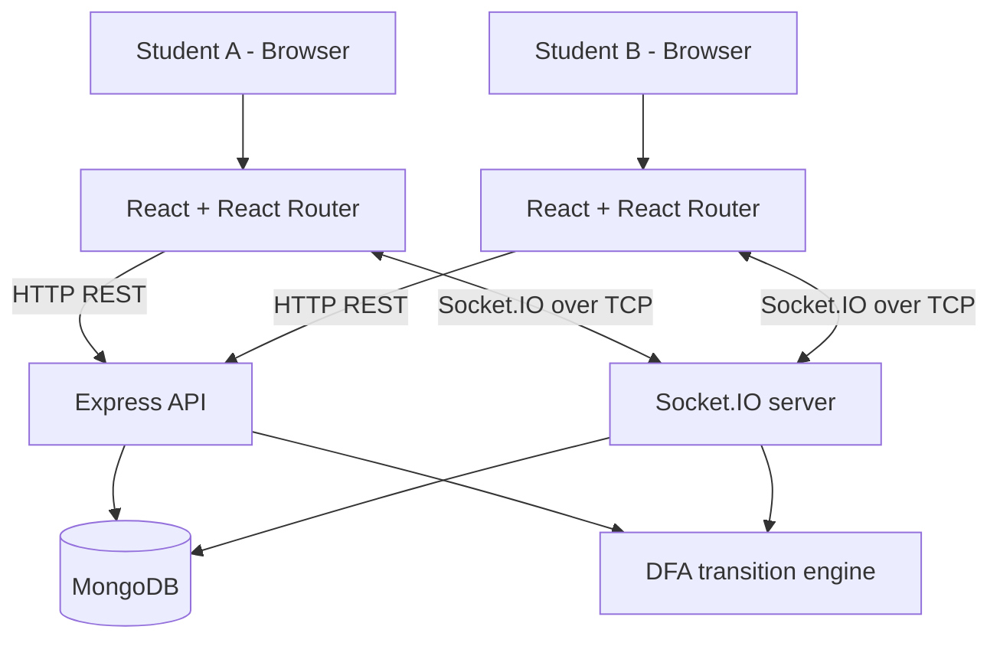

# System Architecture

## Layers
1. Presentation: React components, form state, document editor and DFA screen.
2. Application: Express controllers, authentication middleware, Socket.IO handlers and DFA transition validation.
3. Data: MongoDB collections for users, documents and activities.

## Request lifecycle
A browser sends an HTTP request to Express. Authentication middleware verifies its JWT. The controller validates the request, checks document access and invokes the DFA when an operation changes lifecycle state. Mongoose persists data. Socket.IO broadcasts accepted changes to members of the document room.
