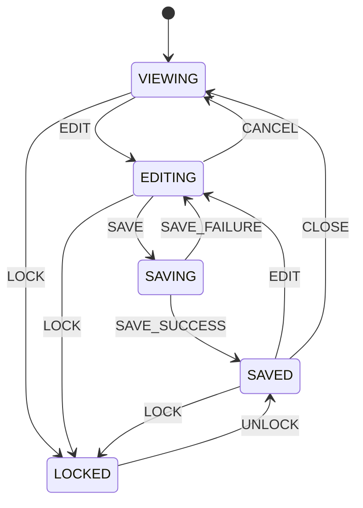

# DFA Specification

A deterministic finite automaton is a 5-tuple `M = (Q, Σ, δ, q0, F)`.

- `Q = {VIEWING, EDITING, SAVING, SAVED, LOCKED}`
- `Σ = {EDIT, SAVE, SAVE_SUCCESS, SAVE_FAILURE, LOCK, UNLOCK, CLOSE, CANCEL}`
- `q0 = VIEWING`
- `F = {VIEWING, SAVED, LOCKED}`
- `δ` is the partial transition function below. Undefined transitions are rejected.

| Current state | Input | Next state |
|---|---|---|
| VIEWING | EDIT | EDITING |
| VIEWING | LOCK | LOCKED |
| EDITING | SAVE | SAVING |
| EDITING | LOCK | LOCKED |
| EDITING | CANCEL | VIEWING |
| SAVING | SAVE_SUCCESS | SAVED |
| SAVING | SAVE_FAILURE | EDITING |
| SAVED | EDIT | EDITING |
| SAVED | LOCK | LOCKED |
| SAVED | CLOSE | VIEWING |
| LOCKED | UNLOCK | SAVED |

## Implementation
`server/automata/documentDFA.js` stores the transition table and exports `transition(currentState, action)`. The Express transition endpoint calls this function before updating the persisted document state. An undefined transition returns HTTP 400 and does not change the state.

## Regular expressions
The backend uses:
- Email: `/^[^\s@]+@[^\s@]+\.[^\s@]+$/`
- Title: `/^[a-zA-Z0-9 _-]{3,100}$/`

These validate practical input patterns. The title pattern recognizes a regular language over its character alphabet.

## Academic note
The automaton models the lifecycle of a document, not arbitrary character-by-character editing. `SAVING` is represented as an explicit state for the academic state-machine demonstration. In this MVP, a REST save commits content and sets the resulting state to `SAVED`; the transition endpoint separately demonstrates the full DFA transitions. For a stricter transactional demonstration, extend the save controller to persist `SAVING`, then apply `SAVE_SUCCESS` or `SAVE_FAILURE` after the database operation.
