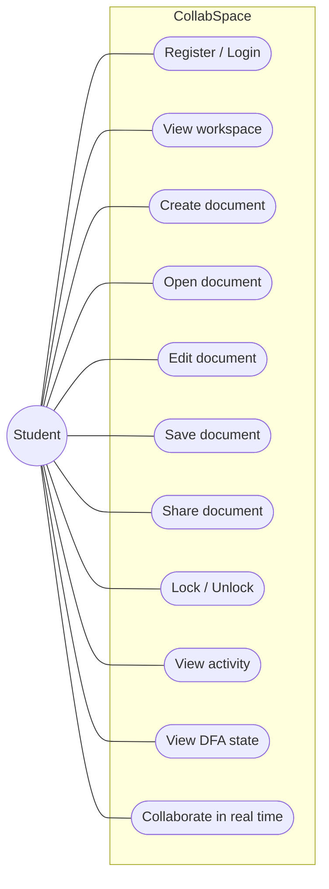

# Use Case Diagram

The document owner creates and deletes documents and can add collaborators. Owners and collaborators can read and edit unlocked documents. The backend verifies access for every protected operation.
